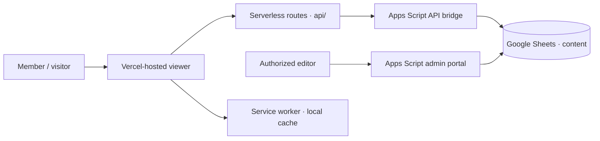

# GMAHK Galilea

**A congregation website and worship companion for GMAHK Galilea, Balikpapan, Indonesia.**

Schedules, worship materials, congregation news, and presentation tools in one browser-based experience. Public content is displayed through a Vercel-hosted viewer; authorized editors maintain records through Google Apps Script and Google Sheets.

[Visit website](https://gmahk-galilea.vercel.app/) · [Administration entry](https://gmahk-galilea.vercel.app/admin) · [Digital archive](https://drive-galilea.vercel.app/)

[](https://github.com/zvenians/gmahk-galilea/actions/workflows/ci.yml)

---

## Why this exists

A weekly church service involves more than a calendar entry. Members need to know when they serve, visitors need clear information, presenters need readable material on large screens, and content editors need a way to publish corrections without editing frontend code.

This project separates the public reading experience from content administration. It provides predictable navigation for the congregation while keeping editing workflows in the Apps Script environment.

## What the site provides

| Area | Visitor-facing behavior |
| --- | --- |
| **Worship schedules** | Upcoming services, duty assignments, calendar views, quarterly PDFs, and locally calculated WITA schedule state |
| **Worship readers** | Bible, Lagu Sion hymns and scores, announcement materials, and full-screen presentation controls |
| **Congregation news** | Articles with supporting media, searchable content, and share links |
| **Devotional resources** | Morning devotionals, Sabbath School resources, mission news, and offering readings |
| **Visit and service information** | Directions, congregation contacts, and service request information with privacy choices |
| **Personal preferences** | Light/dark appearance, configurable colors, reading size, motion preferences, favorites, and locally cached materials |

Offline access depends on resources previously cached by the device. Live data, external media, and administrative actions still require a working connection.

## System design



- **Public frontend:** semantic HTML, CSS, and vanilla JavaScript; the main viewer is assembled from `index.html`, `viewer.js`, and specialized reader and presentation modules.
- **Serverless routes:** Vercel functions under `api/` mediate backend requests and generate image, bulletin, PDF, and article metadata responses.
- **Content backend:** Google Apps Script implements the public data bridge and administration logic; Google Sheets stores editable church records.
- **Admin isolation:** `GET /admin` redirects to the configured Apps Script administration deployment. Requests beginning with `admin` are rejected on the public `POST /api/admin` route.
- **Local behavior:** `sw.js` caches the application shell; scheduled presentation and welcome text uses Balikpapan time (`Asia/Makassar`, UTC+8).

These boundaries are implemented in source and covered by tests, but they are not a substitute for reviewing a live Apps Script deployment's permissions.

## Repository map

```text
.
├── index.html                     Main page and metadata
├── viewer.js / viewer.css         Page rendering and reading experience
├── visitor-ui.css                 Visitor interaction and responsive layout
├── appearance.css                 Appearance palettes and presentation themes
├── schedule-clock.js              WITA-aware schedule updates
├── hymnal-scores.js / .css        Hymn lyrics and score handling
├── sabbath-presentation.js / .css Worship presentation layouts
├── page-turn.js / .css            Reader page transitions
├── sw.js                          Service worker and offline cache
├── api/                           Vercel serverless endpoints
├── apps-script-backend/           Apps Script administration and API bridge
├── scripts/                       Site build and preview generation
├── tests/                         Integration and browser verification
├── docs/                          Operations and verification notes
├── .env.example                   Server-side configuration template
└── vercel.json                    Routes, functions, headers, build output
```

### Notable routes

| Route | Purpose |
| --- | --- |
| `/` | Public congregation viewer |
| `/admin` | Redirect into the authenticated Apps Script portal |
| `/api/gas` | Allowlisted public backend operations |
| `/berita/:id` | Article-specific share metadata |
| `/api/quarterly-pdf` | Quarterly schedule document handling |
| `/api/news-og` | Article preview image generation |

## Local development

**Requirements:** Node.js 20 or newer, npm, and optionally the Vercel CLI for serverless routing.

```bash
git clone https://github.com/zvenians/gmahk-galilea.git
cd gmahk-galilea
npm ci
npm run check
npm run build
```

A static local server can preview the viewer files. For `api/` handlers use the local Vercel runtime, with your **own authorized** environment configuration:

```bash
npx vercel dev
```

Neither a static server nor a local build creates or configures the church's Google Sheets and Apps Script backends.

### Browser checks

```bash
npx playwright install chromium
npm run check:visitor
npm run check:appearance
```

The visitor and appearance checks use browser fixtures. Check real device interaction and actual live data separately before releasing a user-facing change.

## Configuration

Copy the variable names from [`.env.example`](.env.example) into your local or Vercel configuration, without committing credentials.

| Environment variable | Usage | Scope |
| --- | --- | --- |
| `GALILEA_APPS_SCRIPT_API_URL` | Public Apps Script API deployment URL | Server |
| `GALILEA_APPS_SCRIPT_ADMIN_URL` | Authenticated admin deployment URL | Server |
| `GALILEA_API_SECRET` | Shared request secret for the API bridge | Server secret |

Use deployed Apps Script URLs ending in `/exec`. Do not expose the shared secret through browser code, error messages, logs, screenshots, or documentation. The API bridge and the Vercel environment must be configured consistently.

Content editors may update schedules, news, visitor details, and service information through their authorized workflows. Such content changes should not require rebuilding the public viewer.

## Verification

The repository defines these scripts in `package.json`:

| Command | What it checks |
| --- | --- |
| `npm run check` | Viewer/admin integration, schedules, hymns, news, caching, contrast, proxies, and sensitive logging |
| `npm run check:visitor` | Chromium visitor flows and responsive interactions |
| `npm run check:appearance` | Palette and appearance behavior |
| `npm run check:sabbath` | Sabbath presentation behavior |
| `npm run build` | Sabbath-summary prerequisite and public output generation |

The CI workflow is in [`.github/workflows/ci.yml`](.github/workflows/ci.yml). Successful repository checks do not imply that a new Apps Script version has been published.

## Release and cache notes

The Vercel build creates `public-dist/`; it is generated output, not source to commit. Changes to visitor styles or scripts may require synchronized asset version references in `index.html` and the service worker's cache manifest. Test both online reloads and cached/offline states.

The share preview system generates site/article-specific Open Graph assets. Messaging platforms may continue using previously cached previews even after the site updates.

Changes in `apps-script-backend/` require a **separate Apps Script release**. Merging to GitHub alone does not replace an Apps Script deployment. Production deployment should follow explicit review and approval.

## Documentation

- [Visitor improvements verification](docs/visitor-improvements-verification.md)
- [Schedule source verification](docs/schedule-source-verification.md)
- [Hymn score verification](docs/hymnal-scores-verification.md)
- [Vercel setup guide](docs/PANDUAN_PASANG_VERCEL.md) — operational guide in Indonesian
- [Contribution guidelines](.github/CONTRIBUTING.md)

## Data and responsibility

Congregation content may contain personal and pastoral information. Verify accuracy with authorized church staff, keep credentials outside version control, avoid production data in test fixtures, and preserve the distinctions between publicly readable material and restricted administration.

---

**Maintained for GMAHK Galilea Balikpapan.** Developed in the [@zvenians](https://github.com/zvenians) project workspace.
